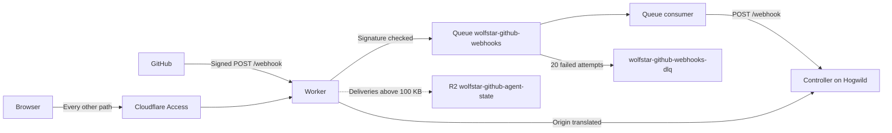

# Wolfstar GitHub Edge

A Cloudflare Worker in front of the [Wolfstar GitHub Agent](../wolfstar-github-agent/README.md). It relays webhooks through a Queue and proxies the dashboard. It runs no Agent: the controller, its sessions, its provider logins and its journal stay on the controller's host.



## Deploy

```sh
pnpm --filter wolfstar-github-edge exec wrangler login
pnpm --filter wolfstar-github-edge exec wrangler secret put GITHUB_WEBHOOK_SECRET
pnpm --filter wolfstar-github-edge deploy
```

The first deploy creates both Queues, the R2 bucket, and its lifecycle rule. Every later run ships an update.

Set these in `wrangler.jsonc` first:

- `CONTROLLER_URL`: the controller's public `https` origin, with no path. It must be a route the controller already serves, such as the Caddy route in [`scripts/public-dashboard.md`](../../scripts/public-dashboard.md). The Worker sends `POST /webhook` and every dashboard request there.
- `GITHUB_WEBHOOK_SECRET`, a Worker secret: the webhook secret of the GitHub App. It is the same value the controller reads from its `webhook.secret_path`. Until it is set, every delivery gets a 503.

Point the GitHub App's webhook URL at the Worker, `https://<worker hostname>/webhook`.

## Cloudflare Access

Put Access in front of the dashboard, so nobody reaches it without signing in first. GitHub cannot sign in, so `/webhook` stays outside Access and keeps its signature check.

1. In Zero Trust, create a self-hosted application for the Worker hostname with an Allow policy for your email.
2. Create a second self-hosted application for the same hostname with the path `webhook` and a Bypass policy for Everyone. The more specific path wins.
3. Copy the first application's Application Audience (AUD) tag and your team domain into `wrangler.jsonc`:

```jsonc
"vars": {
  "ACCESS_TEAM_DOMAIN": "https://<team>.cloudflareaccess.com",
  "ACCESS_AUD": "<aud tag>",
}
```

With both set, the Worker checks the Access token on every request except `/webhook` and refuses one without a valid token, even if a policy is later edited by mistake. Set only one and every request fails, so a half configuration never leaves the dashboard open. The dashboard password still applies behind Access.

## What runs where

| Piece                | Where          | Notes                                                                          |
| -------------------- | -------------- | ------------------------------------------------------------------------------ |
| Webhook intake       | Worker         | Checks the signature with the App's secret, answers 204, queues the delivery   |
| Webhook relay        | Queue consumer | Retries from 10 seconds to 15 minutes, 20 times, then the dead letter queue    |
| Large webhook bodies | R2             | Above 100 KB under `deliveries/`. Deleted once delivered, expired after 7 days |
| Dashboard            | Controller     | The Worker proxies it. The controller checks its password on every route       |
| Agent sessions       | Controller     | A session's terminal stream is a WebSocket, which the proxy passes through     |

The controller keeps every check it has: the webhook signature, the dashboard password, Host and Origin. The Worker translates its public Origin to the controller's, and refuses a state changing request whose Origin is not its own.

## Limits

- **A controller that stays down loses deliveries.** The Queue retries 20 times, for a few hours, before a delivery moves to the dead letter queue. Its R2 body stays for 7 days, and polling still reads the repository.
- **The controller must be reachable from Cloudflare.** `CONTROLLER_URL` has to be a public route. A Tailscale-only address does not work.
- **Desktop session routes stay on Tailscale.** The controller's public route refuses them, so the Worker cannot reach them either.

## Develop

```sh
pnpm --filter wolfstar-github-edge test:run
pnpm --filter wolfstar-github-edge typecheck
```

The tests run the routes in Node against plain fakes for the Queue, R2, and the controller.
